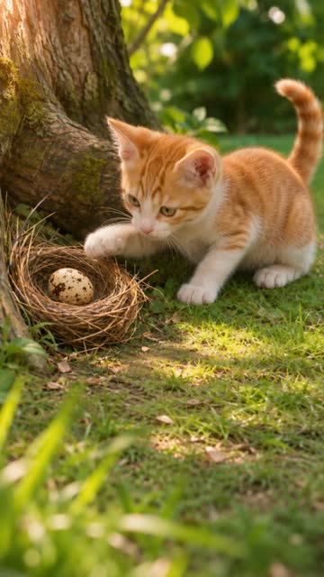

# wukong-drama · 用 AI 把故事拍成短剧

你提想法，助手帮你写故事、设计角色、制作画面和声音。关键步骤先给你看，确认后再继续。可以从一句话开始，也能带上已有剧本或素材。

## 先看一支做好的片子

**《偷蛋的小猫》**：小猫偷来鸟蛋，刚出壳的小鸟却把它当成了妈妈。全片 10 秒，横竖屏各一版。

[看竖屏版](plugin/skills/cinematic/examples/stealing-kitten/media/final/portrait.mp4) · [看横屏版](plugin/skills/cinematic/examples/stealing-kitten/media/final/landscape.mp4) · [看制作过程](plugin/skills/cinematic/examples/stealing-kitten/README.md)

## 可以选什么画风

<!-- progress -->
**目前可以选择 3 种画风**
<!-- /progress -->

<!-- gallery -->
| 类型 | 画风 |
|---|---|
| 东方神韵 | **水墨写意** |
| 卡通漫画 | **二维卡通短剧** |
| 真人影视 | **真人影视短剧** |
<!-- /gallery -->

拿不准就让助手推荐。做连续几集时，可以沿用已确认的角色和设定。

## 开始制作

[下载 0.1.0 安装包](https://github.com/wukongnotnull/wukong-drama/releases/tag/v0.1.0)

1. 按[安装说明](docs/agent-installation.md)，让助手装好插件、检查工具。
2. 按[账号和模型说明](docs/providers.md)，准备生成方式和预算。已有素材也能沿用。
3. 准备好后，把故事和保存位置告诉助手，例如：

> 用 wukong-drama 做一支 10 秒短剧：小猫偷鸟蛋，小鸟出壳后认它当妈妈。真实萌宠风格，不要对白，加俏皮音乐。要横竖屏视频和剪映草稿，保存在【文件夹位置】。

以后接着做，就说“继续这个文件夹里的短剧”。

## 制作时要确认什么

依次确认故事和画风、角色／道具／场景设定、每个镜头的安排和带声音的预览，再生成视频、看小样、定稿。重点检查造型、动作、画面和声音。

当前源码中新片默认使用模型原生声音，可关闭后另配声音；已发布的 0.1.0 安装包仍默认关闭。

“小样”是试看版，终版通常沿用同一批素材；交付时会说明画面、声音和字幕等实际改动。

生成可能收费。**每批生成前先确认方式和费用；视频必须弹窗询问，等你明确同意开始。** 重试、返修和另做横竖屏也一样。详见[费用说明](docs/providers.md#费用怎么确认)。

## 最后能拿到什么

- MP4 成片，以及事先约定的横竖屏、声音和字幕。
- 可选的剪映草稿，方便继续剪辑；与成片的声音差异会在交付时说明。

保留整个作品文件夹，方便修改或续集；剪映草稿另行备份。

安装、配置及维护见[文档导航](docs/README.md)。本项目基于 wukong-animation 开发，见[来源说明](docs/UPSTREAM.md)。代码采用 [MIT 许可](LICENSE)，示范素材见[使用范围](LICENSE-MEDIA)。
