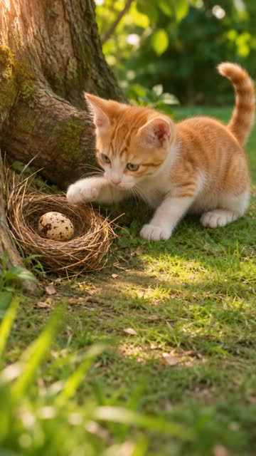

# wukong-drama · 用 AI 把故事拍成短剧

你提想法，助手帮你写故事、设计角色、制作画面和声音。关键步骤先给你看，确认后再继续。可以从一句话开始，也能带上已有剧本或素材。

## 先看一支做好的片子

**《偷蛋的小猫》**：小猫偷来鸟蛋，刚出壳的小鸟却把它当成了妈妈。全片 10 秒，横竖屏各一版。

[看竖屏版](plugin/skills/cinematic/examples/stealing-kitten/media/final/portrait.mp4) · [看横屏版](plugin/skills/cinematic/examples/stealing-kitten/media/final/landscape.mp4) · [看制作过程](plugin/skills/cinematic/examples/stealing-kitten/README.md)

## 可以选什么画风

<!-- progress -->
**目前可以选择 3 种画风**
<!-- /progress -->

<!-- gallery -->
| 类型 | 画风 |
|---|---|
| 东方神韵 | **水墨写意** |
| 卡通漫画 | **二维卡通短剧** |
| 真人影视 | **真人影视短剧** |
<!-- /gallery -->

拿不准就让助手推荐。做连续几集时，可以沿用已确认的角色和设定。

## 开始制作

[下载 0.1.0 安装包](https://github.com/wukongnotnull/wukong-drama/releases/tag/v0.1.0)

1. 按[安装说明](docs/agent-installation.md)，让助手装好插件、检查工具。
2. 按[账号和模型说明](docs/providers.md)，准备生成方式和预算。已有素材也能沿用。
3. 准备好后，把故事和保存位置告诉助手，例如：

> 用 wukong-drama 做一支 10 秒短剧：小猫偷鸟蛋，小鸟出壳后认它当妈妈。真实萌宠风格，不要对白，加俏皮音乐。要横竖屏视频和剪映草稿，保存在【文件夹位置】。

以后接着做，就说“继续这个文件夹里的短剧”。

## 完整制作流程

当前源码 0.2.0（尚未发布）中新片默认使用模型原生声音，可关闭后另配声音；已发布的 0.1.0 安装包仍默认关闭。

以下为当前源码的 **14 步流程、11 个审片确认点**。字幕、副版和剪映草稿按需执行。

| 步骤 | 做什么 | 需要你确认什么 |
| --- | --- | --- |
| 1. 准备工程 | 检查工具，新建或恢复作品 | 无固定确认；保存位置不明时才问 |
| 2. 制作简报 | 定故事方向、时长、画幅、声音和交付要求 | ✅ 确认整份简报 |
| 3. 选择画风 | 看视觉方案，选画风、色彩和质感 | ✅ 选择方案 |
| 4. 编写剧本 | 写故事、对白、配乐和音效方向 | ✅ 确认剧本 |
| 5. 角色／道具／场景设定 | 准备每个角色的设定图，以及道具／场景的必要参考 | ✅ 集中确认；未变的已有设定沿用 |
| 6. 安排分镜 | 写清每镜时长、声音，以及开始画面、怎样运动、结束画面 | ✅ 确认分镜 |
| 7. 分镜图和节奏预演 | 按首帧提示词做图，看构图和动作初态，预演节奏 | ✅ 确认画面和节奏 |
| 8. 制作镜头视频 | 按三栏提示词和声音要求生成；难镜先试，好素材直接选段 | **每批生成前确认开始**，不另设审片点 |
| 9. 制作字幕 | 按实际人声核对文字、时间和版式 | ✅ 需要字幕时确认；已明确不要则跳过 |
| 10. 小样审查 | 一起看单镜动作、镜间衔接、全片节奏，听声音、查字幕 | ✅ 集中审查，一次确认 |
| 11. 制作终版 | 用已通过素材完成混音、字幕和最终导出 | 无单独确认 |
| 12. 终审与交付 | 展示最终文件，说明相对小样的变化 | ✅ 确认终版 |
| 13. 制作其他画幅 | 调整横竖版构图和字幕，沿用主版声音 | ✅ 有副版时审查；没有则跳过 |
| 14. 交付剪映草稿 | 检查能否打开、素材、轨道、字幕和声音差异 | ✅ 需要草稿时确认；只要成片则跳过 |

分镜新增 **首帧提示词、过渡提示词、尾帧提示词**，分别写“开始什么样、怎么动、结束什么样”，直接用于生图和视频。尾帧目前只是文字目标，剪辑后还要核对；横竖版共用动作和声音，分别调整构图。修改后只重审受影响内容。

参考图要看清这些内容：

| 类型 | 画面要求 |
| --- | --- |
| 角色 | 每个角色一张图，包含正面、侧面、背面，以及表情和动作参考 |
| 道具 | 看清完整外形、颜色材质、关键细节和大小；剧情需要的开合、完整／破损等状态标清楚 |
| 场景 | 全景看清布局、出入口、主要物件位置和空间大小，统一时间、天气与光线方向 |

重点道具、重复出现或位置关系重要的场景必须有参考图，其余按需简化。道具的其他角度、细节图，以及场景俯视布局图、其他机位图按镜头需要补充。视频首帧按镜头另做。

“小样”是试看版，终版通常沿用同一批素材；交付时会说明画面、声音和字幕等实际改动。

声音随小样一起审，不再单独确认声轨；选独立 AI 配音时，先试听选音色。已确认且未变化的内容沿用，返修只重审相关部分。

**生成前还要确认本批任务和费用：**

- **图片**：每批先选来源，说明任务、数量和已知费用，等你确认再生成。
- **视频**：每批必须弹窗列明模型、数量、每条时长、预计费用和预算，等你明确同意开始。试拍、重试、返修和副版都一样；不支持弹窗时改用文字确认。

详见[费用说明](docs/providers.md#费用怎么确认)。

## 最后能拿到什么

- MP4 成片，以及事先约定的横竖屏、声音和字幕。
- 可选的剪映草稿，方便继续剪辑；与成片的声音差异会在交付时说明。

保留整个作品文件夹，方便修改或续集；剪映草稿另行备份。

安装、配置及维护见[文档导航](docs/README.md)。本项目基于 wukong-animation 开发，见[来源说明](docs/UPSTREAM.md)。代码采用 [MIT 许可](LICENSE)，示范素材见[使用范围](LICENSE-MEDIA)。
