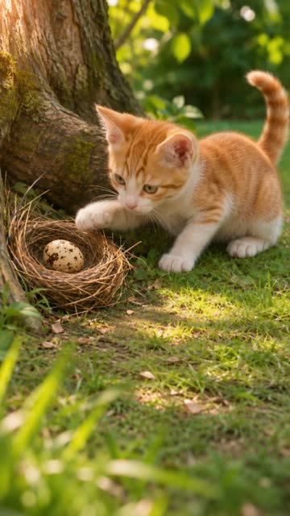

# 《偷蛋的小猫》· 真实萌宠示范片

已实际生成并由用户验收的10秒轻喜剧：小猫偷到鸟蛋，出壳的小鸟却认它当妈妈。2026-11-05完成两版成片和两份剪映草稿验收，随后用户指定收录为插件示范片。

| 竖屏9:16 | 横屏16:9 |
|---|---|
| [](media/final/portrait.mp4) | [](media/final/landscape.mp4) |
| [播放竖屏成片](media/final/portrait.mp4) | [播放横屏成片](media/final/landscape.mp4) |

两版均为10秒、24fps、六镜，每镜不超过2秒。编码尺寸为1080×1920 / 1920×1080；**模型原生素材为720p**，不是原生1080p。无人声、无字幕；声音为原创程序合成配乐与拟声，非动物实录。

## 制作资料

- [制作简报](brief.md)、[剧本](story.md)、[分镜与实际切点](storyboard.md)。
- [角色／道具／场景档案](designs.json)及 `media/designs/` 中四张实际参考图。
- [工程](film.json)与 `shots/` 中六镜提示词、主副版本地视频引用。
- `audio/build.mjs` 保留原声音合成脚本；离线重渲染使用 `media/audio/` 中已批准的三条声音文件。
- [制作来源与媒体哈希](provenance.json)、[媒体使用说明](MEDIA.md)。

设定档案记录原作品的设计依据。离线示例复用已审阅本地视频，镜头不声明 `settings` 字段，不移植个人工程的活动审批。重新创作、改角色或调用模型时，须为新项目建立并确认设定。

## 离线重渲染

先把本目录完整复制到**独立工作目录**，不要直接在插件目录制作。配置本地渲染依赖后，对副本执行：

```text
node <插件目录>/engine/bin/wkd.mjs final <示例副本目录>
node <插件目录>/engine/bin/wkd.mjs final <示例副本目录> --aspect 16:9
```

输出 `replay.mp4` 和 `replay-16x9.mp4`，包内成片仍保存在 `media/final/`。两版均导入现有视频与声音，不需要API密钥、不提交模型任务。示例不附活动进度与签批；独立副本的主版不变报告可能提示没有本机定稿快照，不能据此声称新项目已审片。

复制后的工程也可执行 `final <示例副本目录> --aspect all --formats jianying`，在保存并退出剪映后，导出到本机草稿目录。原用户个人草稿不随插件分发；草稿保留分轨，但没有成片整体响度标准化与统一尾部淡出。

## 学习边界

- 图片由Codex内置imagegen生成；视频由Seedance 2.5生成，每种画幅分别只有一次10秒多镜头任务，横屏参考竖屏定稿排构图。
- 这是本片制作记录，不表示插件逐镜 `render` 已支持自动提交整片多参考图任务。离线示例通过已核对的本地视频接入后期。
- 实际切点与最初计划略有偏移，经本地对齐及用户签批；重生成不保证复现相同动作或切点。
- **任何新一批视频生成、重试、返修或副版生成，都先弹窗展示模型、数量、时长、费用和预算，等待明确开始授权。** 无弹窗时文字提问；复用本例不构成付费授权。
- 示例预算与任务上限均为0；重新生成须按导演流程核实当前模型、定价、设定及审阅要求，不沿用原片授权。
